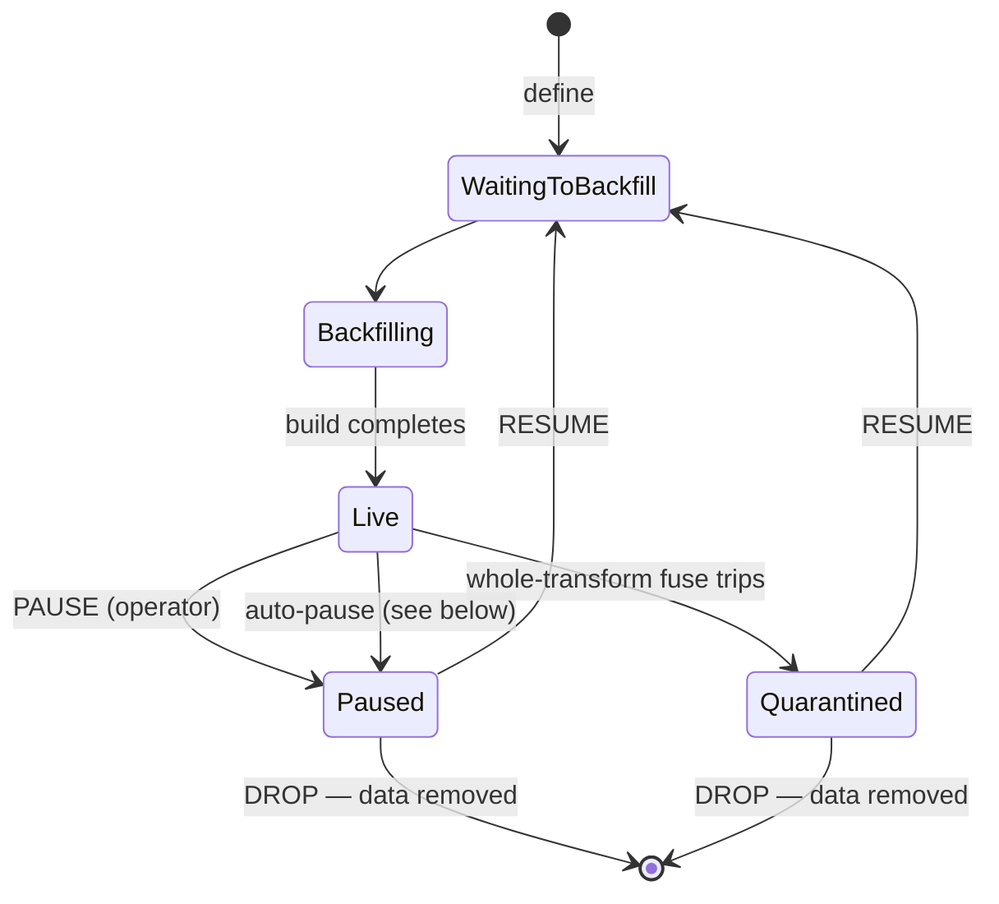

# Pausing and Dropping a Definition

Defining derived state is only half a lifecycle. A transform can also need to stop:
frozen while an operator investigates or stages a schema change, or removed entirely.
This ADR settles that other half.

## The lifecycle

A definition is frozen in one of two statuses, and both stop the claim-time fold from
writing to the target and hold its current, now-stale value. `paused` is reached by an
operator's `PAUSE`, or by the engine when it cannot maintain the definition:

- **Capture failure.** A column the definition reads was renamed or dropped, or its
  source's primary key was redefined, or row-level security came to apply to the Trellis
  role on a table it reads or on its target, or a logical-replication subscription began
  replicating into a table it reads. The reason is on the status's `capture_failure`.
- **Repeated build failure.** A build chunk kept failing in a way no retry or narrowing
  gets past (a missing table or column, say). The error stays on `backfill_failure`.
- **A halting drain failure.** A failure every key reproduces (a source with no usable
  primary key, a propagation wave past the hop bound, an aggregate the group basis can't apply)
  pauses every definition it reaches and everything downstream of them, so the rest of the
  page commits instead of retrying forever. Recorded on `capture_failure`.

`quarantined` is the whole-transform poison fuse ([ADR-0003](0003-quarantine-storage-and-api.md)):
too many poisoned source rows. It is a separate status so that poison incidents stay
distinguishable from an operator's pause. From either, an operator resumes, which
reconciles the target with current source data, or drops it, which removes the
definition and its data. Every freeze stays until an operator acts.

Drop acts only on a frozen definition (`paused` or `quarantined`). There is no direct
live-to-gone edge: quiescing first is a precondition, so the removal never has to reason
about a fold still dispatching to the target.

## Decisions

### Pause is one freeze with several triggers

An operator pause, an engine auto-pause and the poison fuse all freeze a definition by
the same status gate the fold already honors. There is no second freezing mechanism. A
freeze is durable until an explicit resume. Column-level quarantine is this same idea at
column granularity: a paused column holds a deliberately stale value while the rest of
the target stays live. A column pause freezes the column from the moment it returns. It
bumps its source's version fence, so a drain page or build chunk that planned the column
as live either commits before the pause does or finds the fence moved and plans again
without it. The pause then cascades to the column's readers, each fenced the same way in
a transaction of its own. If a reader's fence bump waits out the lock timeout, the pause
returns the error and stays marked as owing its cascade, and the staging worker's capture
pass finishes the cascade. A definition defined, or a field added or edited, while a
column it reads is paused is paused at birth, and that column's resume releases it. An
edited field that already has readers owes their cascade, which the edit walks once it
commits. If that walk fails, the edit still succeeds and the capture pass finishes it.

### One lock orders every column-pause write and read

Every read-to-decide and write of a column's pause state (`column_status` rows, cascade
edges, the marks that a pause still owes its cascade) goes through one transaction-level
advisory lock per instance, taken by one helper (`locks::lock_column_pauses`). The key is
`(922, hash(instance schema))`: advisory locks are scoped to the database, not the schema, so
a constant key would make instances that share a database wait on each other
([instance identity](../instance-identity.md)). Nothing it orders crosses instances: the
state it guards lives in the instance's catalog schema, and an instance that reads
another's target sees that target as an ordinary source, never its pause state. Column
pauses are operator commands plus rare fuse trips, so correctness and simplicity win over
concurrency here. An earlier design locked each target by name; two deadlocks came from
the sites it missed (a define against a `RESUME`, a `DROP TRANSFORM` against a `RESUME`),
and each fix needed its own lock-order argument. One lock makes those cycles impossible
by construction.

- **Exclusive:** a pause, a column fuse trip, each pair of a cascade, `RESUME`, `DROP
  TRANSFORM`, an `ALTER TRANSFORM` that builds or drops a field, and the build start that
  releases the pauses an `ALTER` made while it awaited its source's capture.
- **Shared:** a define. It reads the pause state of what it reads and writes only its own
  new target's rows, and defines don't wait on each other. It holds the lock for its
  catalog transaction only: validation, the definition and edge rows, and the read of its
  upstreams' pauses. It never holds it across the build or backfill it starts.
- **Order.** A transaction takes, in this order: its source's version fence, when it needs
  one; the lock; the fuse gate, when it needs one; definition and `column_status` rows.
  The lock comes after the fence wait so that a pause waiting up to the lock timeout on
  busy writers never holds it, and before the definition row, which the fuse and
  `evict_for` take after the gate. No site that takes this lock takes the gate today.
- **Timeout.** The wait ends at the transaction's `lock_timeout` (30 s, or the one second
  of a capture-pass cascade pair). The transaction rolls back with nothing written and
  the caller gets a retryable error (`ErrorCode::Timeout`). A fuse trip and the capture
  pass's callers retry on their next pass. Each timeout is counted by
  `column_pause_lock_timeouts_total{op}` ([observability](../observability.md)).
- **Costs accepted.** Pauses, resumes and fuse trips on unrelated targets of one instance
  serialize. A holder that stalls, such as an idle-in-transaction session, blocks that
  instance's pause activity until `lock_timeout`. A fuse trip in the capture pass can
  wait briefly behind an operator pause.

### Resume reconciles with source, not by catch-up

A paused definition must not pin the staging ring. Holding ring segments open for a
paused target would wedge the ring for every other definition reading the same source.
So while a definition is paused, its share of the change stream is drained for its
siblings and is not recoverable by replay.

Resume therefore reconciles the target with current source data rather than catching up
over buffered changes, because there are none. The target is not cleared and rebuilt.
Readers keep seeing its rows throughout, and the reconciliation has two halves, committed
together in one transaction and read on one snapshot:

- Every target row that no current source row backs is deleted. That covers a 1-1 row
  whose source row was deleted, and an aggregate group whose rows were all deleted or
  moved to other groups.
- Every current source row is re-derived by a Re-derive build. A 1-1 definition
  restarts it over the existing ledger entries, and its sweep re-derives each
  live entry no chunk reached (a key deleted while frozen), tombstoning the
  entry, and, for a 1-1 target, each target row
  with no live entry (one added or re-keyed by hand). An aggregate or a `JOIN` is
  rebuilt by one absolute write that replaces every group, and removes the groups
  the source no longer has. `RESUME` first bumps the source's
  version fence and discards the definition's unclaimed backfill chunks.

Deletions are visible the moment that transaction commits. Rows whose values changed
during the pause stay stale until the drain re-derives them, and rows the source gained
appear the same way. The deletes, the build's included, go through the target-mutation
seam like any other target write, so a live definition reading this target drops them too.

Before any of that, resume re-validates the definition against the live schema, with
the same checks define runs: its fields over the source's
live columns, the source key's type and collations, a `JOIN`'s `ON` columns (still on
the allowlist, with matching types and collations), row-level security and subscriptions, and, for a 1-1 definition, a
source key that is still the one its target is keyed by. While define would refuse
it, the resume refuses with define's error, names the column and what to change, and
changes nothing: the definition stays paused. A 1-1 definition also needs its ledger
table to exist (only a hand edit drops it). The resume refuses that too, names `DROP TRANSFORM`, and changes nothing; a column resume
doesn't make these checks, since it builds nothing. A field resume runs define's validation on
its definition, and leaves a dependent its cascade reaches paused while that
dependent's check fails. The dependent's check runs on the definition read under the
column-pause lock, which every `ALTER TRANSFORM` that changes it takes exclusive, so it is
the definition the resume then builds, checked against the schema as it is then. An edit
that makes the definition valid again before the lock releases the dependent, and a
source change before the lock that makes it invalid holds it.

A resume then rebuilds from the schema as it is now. It records the source's live
column types, which the rebuild casts through, and the type of each column the
definition keys by (`definition_key_types`), which the staging worker's capture pass
compares later changes against. The pass records a key column's new type itself when it
accepts a change to it without a pause. And the resume brings every column Trellis
created for the definition with a type that comes from the source to the type define
would give it now. Some are copies of one source column: a 1-1 target's key and
passthrough columns, an aggregate's `GROUP BY` columns in its target, and a `JOIN`'s `GROUP BY` and `ON` columns in its target and hidden
tables. Others are typed by an expression, and
take the type define's inference gives it over the live schema: a 1-1 target's
calculated fields, an aggregate's or a `JOIN`'s field columns (`SUM(qty)` is `bigint` over an
`integer` `qty` and `numeric` over a `bigint` one). The staging worker's capture pass pauses a
definition when the source widens past one of these columns, and the resume re-types
every one whose type differs from define's, whichever change made it differ. Re-typing
one is an `ALTER … TYPE` under `ACCESS EXCLUSIVE`, which waits for every reader of the
table and, for `integer` to `bigint`, rewrites it, so it never runs inside `RESUME`: a
resume with columns to re-type records a request (`resume_requests`) and returns at
once, the definition still paused, and the staging worker's next capture pass re-types
them, one table per transaction, then runs the resume itself. A crash between the two
leaves the request, and the next pass (or the next `RESUME`) finishes the work. So does
a table whose re-type fails transiently (a lock it can't get in time, a deadlock, a
serialization failure, a cancelled statement, a lost connection): the request stays,
and the next pass tries again, each retry updating the `capture_failure`'s
"resuming: …" text with the last error. Trellis sets no `statement_timeout` of its own
and honours the operator's, so a rewrite that outlasts it is cancelled (`57014`),
rolled back and retried on the next pass, with the table locked `ACCESS EXCLUSIVE` up to
the timeout each time. The request counts those cancellations (`resume_requests.timeout_cancels`,
reset by every `RESUME`) and ends after 3, with an error that names the timeout and both
remedies: raise `statement_timeout` for Trellis's role or database, restart Trellis (a role
or database setting reaches only new connections, and the staging worker keeps its own
open) and `RESUME` again, or `DROP TRANSFORM` and define it again, which isn't subject to
the re-type rewrite. A `pg_cancel_backend` of the re-type is a `57014` too, and counts the
same way. A lock
timeout or a lost connection isn't counted. A column whose re-type fails otherwise (a value its new
type can't hold) ends the request with the error on the definition's
`capture_failure`, and leaves that table's columns as they were; another table's,
re-typed before it, keep their new types, and the next resume finds them current. The target keeps its rows. When its values can't be converted (a key
moved from `text` to `uuid` by a `USING` that isn't a cast), the error names the repair:
`DROP TRANSFORM` and define the definition again, which builds the target from empty.
Trellis doesn't empty the target itself, because the application reads it: emptying it
is the operator's call. The resume always rebuilds after it re-types. Each re-type keeps
the column's collation.

A resume that re-types a definition's target can pause the definitions chained off it,
when a column Trellis created for one of them, typed from the target's column, no longer
has the type define would give it. The re-type's transaction records which definition's
resume re-typed each target column (`retype_causes`). When the capture pass pauses a
chained definition only for columns that resume re-typed, the pause records the upstream
definition as its cause (`capture_failures.caused_by`), and the `capture_failure` names
the upstream resume rather than a column the operator never altered. It says the chained
definition resumes on its own once the upstream is live again, since its rebuild reads the
upstream's target.

At the start of each capture pass, before it finishes the requested resumes, the pass
resumes each definition paused with a cause whose upstream is `live`, with no resume
request: its rebuild has finished, so each downstream rebuild starts only after
the one above it, and one `RESUME` of the head carries the chain. It takes the path an
operator's `RESUME` takes, in one transaction, under the definition's lock, after
re-reading that the definition is still frozen with the same cause: a `RESUME` by hand
that commits first wins. With no copy to re-type the definition resumes. With copies to
re-type the request is recorded and the cause cleared, and the same pass re-types them
and completes the resume. That re-type pauses the next definition down with this one as
its cause, so the chain goes on one level per upstream rebuild. A definition whose
resume is refused, because the schema changed after the pause, stays paused with the
refusal on its `capture_failure` (the text of a refused request) and no cause, so the
next pass doesn't try it again. Nothing below it was paused, since its target was never
re-typed. The queue is durable without a table of its own: the cause and the resume
request are the two states a definition passes through, each move is one transaction,
and a crash leaves one of them for the next pass to go on from. A chained re-type that
fails ends the request like any other: the definition stays paused with the error and no
cause, its target keeps its types, and nothing below it is paused. A chained definition the
re-type leaves refused, failing its own re-validation (a `SUM` over a column re-typed
to a float), keeps its own error and records no cause. So does one already paused for
another reason, by the operator or by quarantine, and the pass leaves it alone.

A resume that re-types a column of a definition's target also re-validates, in the
same transaction, every definition that reads that column, with define's whole
validation against the schema as the re-type leaves it (a group-basis `SUM` over a
column that is no longer `numeric(p,s)`, a `JOIN` key pair that no longer matches). A
reader define would now refuse is paused there, with the refusal and the upstream
re-type as its `capture_failure` and no cause: its own `RESUME` re-validates and
refuses until the operator redefines it. A reader that stays valid is untouched by this
step. The capture pass never sees such a re-type, because a target is not captured, so
nothing else re-validates the reader. The re-type's transaction locks the definition row
of every reader of the re-typed columns, in id order, before it takes `ACCESS EXCLUSIVE`
on the target: a definition's row comes before a table, as in a build's start and an
`ALTER TRANSFORM`, so a transaction that holds a reader's row and then reads the target
is never deadlocked by the re-type, and a wait for a row holds nothing on the target. A
wait that reaches the re-type's lock timeout is retried by the next pass.

A resume never starts a rebuild ahead of its upstream. A definition's upstreams are the
definitions in the instance whose targets it reads: its source or a `JOIN`'s joined
table. An upstream is `live` as the operator reads it: one that is
itself running but reads a definition that isn't `live` reports `catching_up`, since its
target may still change under a rebuild above it. One that reports `catching_up` only
because it reads a paused column of an upstream 1-1 target (ADR-0003, "Propagation") keeps
applying as usual, so it counts as `live` here. A `RESUME` of a definition with an
upstream that isn't `live` (paused, quarantined, rebuilding or catching up) is accepted
and returns at once, before any re-validation: the definition stays paused with a resume
request, and its `capture_failure` says it is waiting for that upstream to be `live`. This holds whether it
was waiting on an upstream's chained resume or paused for any other reason. The capture
pass completes the request once every upstream is `live`, by the same path as a request
with copies to re-type: it re-validates, re-types copies if needed, then rebuilds. A
re-validation that fails then ends the request with the refusal on `capture_failure`, and
it isn't retried. So an operator can resume a whole stack at once, in any order, and it
comes up in dependency order: the head rebuilds first, and each definition below rebuilds
once the one above it is `live`. Definitions form no cycle, so the order always exists.
A definition whose upstream nobody resumes keeps waiting, its `capture_failure` naming
the upstream; it never resumes past a paused upstream, or past one reading a paused
definition further up.

A `PAUSE` of a definition waiting to be resumed, on an upstream's chained resume or on a
resume request, withdraws that resume: in one transaction it clears the cause and deletes
the request, and the definition stays paused like any operator pause. Its
`capture_failure` no longer says it resumes: an upstream's reason is kept and ends with how
to resume it, and a request's "resuming: …" text says the operator withdrew it. `apply`
reports it as a pause, as it does every pause; that changed `capture_failure`, and the
instance log's line saying the pause withdrew a resume, tell it apart from the no-op
pause of a definition already frozen.

Outside a resume, Trellis never re-types a column: every column it creates from a source
column has the source column's type with no type modifier
([ADR-0020](0020-type-identity.md)), so a change of a modifier leaves it holding every
value, and only an integer or float width outgrows it, which pauses as above.

Resume also releases every key the definition holds in quarantine: it deletes the
definition's own `poison`, `poison_held` and `key_deaths` rows in the same transaction.
The re-derivation covers every key from the source, so the parked work is superseded
rather than replayed, and a key whose cause is still there fails again and is quarantined
again. Whole-key poison is per transform, so every other definition's held keys are
untouched
([ADR-0003](0003-quarantine-storage-and-api.md#releasing-held-keys)).

A long pause is not free: the cost of resuming scales with the data, not with the length
of the pause. This is the contract, stated so a caller does not expect a cheap resume.

### Drop always removes the associated data

Dropping a definition drops its target table; dropping a single derived column drops
that column's data. There is no option to retire the definition while keeping the data —
a caller who wants the derived data to persist without being maintained leaves the
definition paused. Keeping the derived rows after removing the definition that explains
them has no use we can name, and the paused state already serves it.

Because the target table and its columns are Trellis-owned, dropping them is Trellis's
to do. Source tables remain user-owned and untouched. That ownership holds because
registration only ever creates a target table: it refuses a transform whose target name
already names any relation, so a table Trellis later drops is always one it created.

### Drops go in reverse dependency order — no cascade

If any definition still chains off the target being dropped, the drop is refused and names
the definitions that depend on it. Trellis does not cascade the removal, and does not
leave a dependent silently deriving from a table that is about to disappear. The operator
retires dependents first. The refusal names them so the order to follow is explicit.

A dependent blocks whatever its status — being registered at all is enough. A dependent
mid-backfill is reading the target right now; a paused one is worse, because resume
reconciles it against its source, so a dependent frozen over a dropped source can never be
resumed. Only a fully retired dependent stops blocking. Reverse dependency order
therefore means *dropping* the dependents first, not merely pausing them.

### In-flight work is quiesced by the pause, never by deleting shared state

Only per-definition backfill work is keyed to the definition and removed with it; a chunk
a drain worker holds is released on its own heartbeat. Everything else that in-flight work
touches — ring segments and claims — is keyed to the *source* table and co-owned by every
definition reading it, and each sibling definition's quarantine is its own. A drop never
deletes that state out from under a running worker. The pause is what makes this safe: once paused, the fold no longer
dispatches to the target, so a page planned after the pause skips it while its siblings
continue, and the drop then removes only what the target itself owns. A page planned
before the pause can still write the target after the pause returns. The drop waits for
it: as its first lock, the drop bumps the version fence of every table the definition
reads (both tables of a `JOIN`), which waits for each page holding that fence and makes a
later page plan again without the definition.

### Quarantine state follows its owner

Target-keyed quarantine bookkeeping — the per-column status a target accumulates — is
dropped with the target; its forensic value goes with the data. The whole-key poison band
is per definition too (`poison`, `poison_held` and `key_deaths` carry the definition's id),
and goes with the definition row by `on delete cascade`, so a definition defined again
starts with no held keys. A sibling definition on the same source keeps its own.

### Capture shrinks by reconciliation

A drop does not touch the source table. It removes the definition's catalog rows, and
the staging worker's reconcile pass, which derives what to capture from the catalog every
`reconcile_interval`, uninstalls a source table's capture triggers once nothing reads it
any longer. A table a sibling definition still reads stays captured. Correct by
construction, with the catalog as the only input.

The uninstall is deferred to that pass rather than applied at drop time
([ADR-0002](0002-async-data-flow.md#capture-by-statement-triggers)): the staging worker
is the only process that changes a source table's triggers, so dropping a transform
needs no privileges on the source. The cost is that the table's changes keep being
staged for up to one `reconcile_interval` with no reader, which is harmless, because
apply skips a table nothing reads.

### Pause and drop are idempotent

Defining runs on Trellis's own connections, not inside a host application's migration
transaction, and so does its inverse. A migration that is replayed or rolled back must be
safe in both directions, so pausing an already-paused definition and dropping an absent
one are no-op successes. The two states a caller can be uncertain about — "did the pause
land?", "is it already gone?" — resolve to success, not error.

### Pause, resume, and drop are grammar, entered through the one facade entrypoint

They are not separate typed methods and not staging internals reached around with SQL.
Each is a statement in Trellis's grammar, submitted through the single definition
entrypoint the facade exposes — the same entrypoint and grammar that define a transform,
the same text the CLI speaks. The engine parses the statement to
decide the operation and composes it behind the facade, returning plain data.

## Consequences

- Every definition has a reversible freeze and a terminal removal. The freeze holds stale
  data; the removal takes the data with it.
- A long pause costs a full re-enumeration of the source to resume, because the change
  stream is drained for siblings while paused.
- Removal is safe under load: it quiesces through the pause and touches only
  definition-owned rows, never shared source-keyed staging state or a sibling's poison.
- A framework migration's rollback is honest: pause-then-drop, idempotent in both
  directions, even though it does not share the host's migration transaction.
